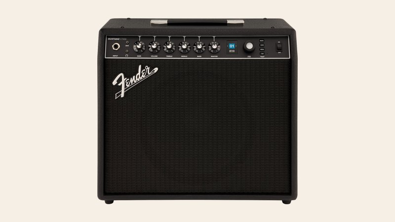
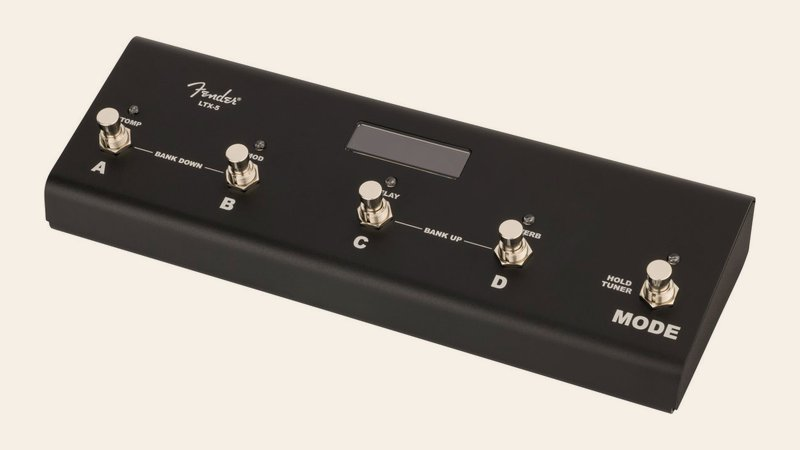
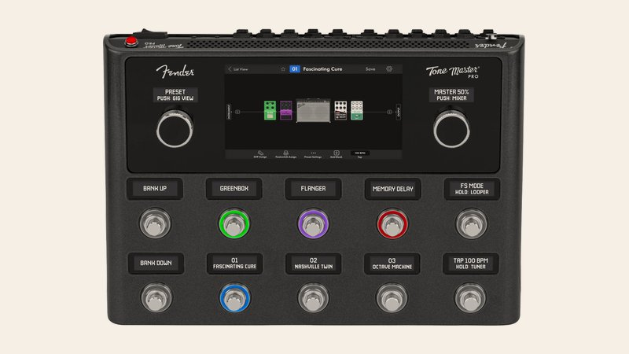
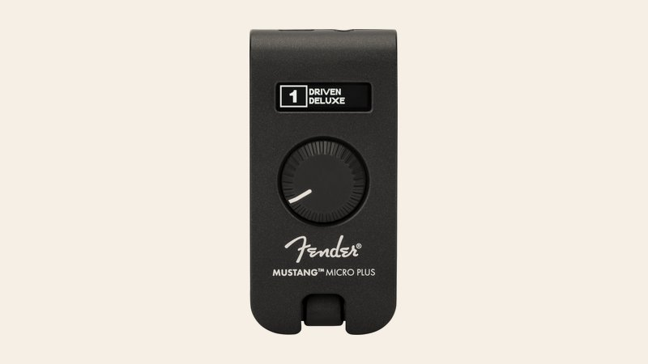
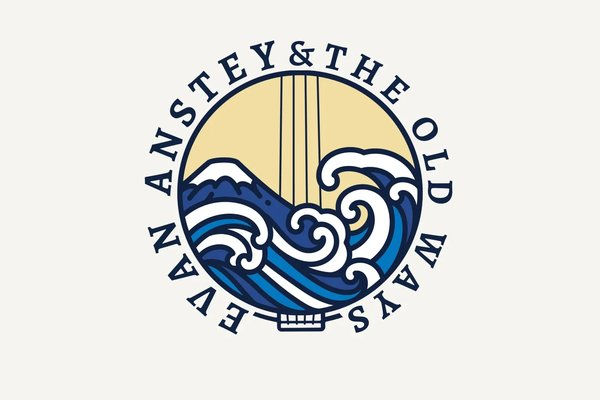

&nbsp;&nbsp;&nbsp;&nbsp;

Hey there, I'm [Ryan Printup](https://ryanprintup.com). I live in Buffalo, NY and work as an Embedded Software Engineer at Fender, building the firmware inside digital guitar amplifiers and effects. I've been writing code and playing guitar since I was 12. Outside of work, I write music, try new recipes, and run to burn off the results.

<h2><picture><source media="(prefers-color-scheme: dark)" srcset="./media/headings/work-dark.svg"></picture></h2>

<table>
	<tbody><tr>
		<td width="50%" valign="top">
			

			<strong><a href="https://www.fender.com/products/mustang-ltx100">Mustang LTX</a></strong> 
			Digital guitar amps with 50 amp and effect models, 100 presets, a color display, and Bluetooth audio.
		</td>
		<td width="50%" valign="top">
			

			<strong><a href="https://www.fender.com/products/ltx-5-footswitch">LTX-5 Footswitch</a></strong> 
			A five-button remote for presets, effects, tap tempo, and the tuner on Mustang LTX amps.
		</td>
	</tr></tbody>
	<tbody><tr>
		<td width="50%" valign="top">
			

			<strong><a href="https://www.fender.com/products/tone-master-pro">Tone Master Pro</a></strong> 
			A multi-effects guitar workstation with a 7-inch touchscreen.
		</td>
		<td width="50%" valign="top">
			

			<strong><a href="https://www.fender.com/products/mustang-micro-plus">Mustang Micro Plus</a></strong> 
			A pocket-sized amp for playing guitar through headphones.
		</td>
	</tr></tbody>
</table>

<h2><picture><source media="(prefers-color-scheme: dark)" srcset="./media/headings/music-dark.svg"></picture></h2>

I play guitar, mandolin, and bass with three groups. See where I'm playing next on my [shows page](https://ryanprintup.com/shows).

<table>
	<tr>
		<td width="33%" valign="top">
			

			<strong><a href="https://www.facebook.com/EvanAnsteyMusic">Evan Anstey &amp; The Old Ways</a></strong> 
			Folk &amp; Bluegrass
		</td>
		<td width="33%" valign="top">
			

			<strong><a href="https://www.facebook.com/whiskey.river.96">Whiskey River Band</a></strong> 
			Country, Rock &amp; Blues
		</td>
		<td width="33%" valign="top">
			

			<strong><a href="https://onechurchny.com">One Church NY</a></strong> 
			Praise &amp; Worship
		</td>
	</tr>
</table>

<h2><picture><source media="(prefers-color-scheme: dark)" srcset="./media/headings/skills-dark.svg"></picture></h2>

<table>
	<tr>
		<td width="26%"><strong>Languages</strong></td>
		<td>C, C++, C#, Python, JavaScript, Dart, Swift, Bash, MATLAB, HTML5, CSS3</td>
	</tr>
	<tr>
		<td width="26%"><strong>Practices</strong></td>
		<td>Device Drivers, Bootloaders &amp; Field Updates, Real-Time Firmware, Digital Signal Processing, Unit Testing, CI/CD, Code Review</td>
	</tr>
	<tr>
		<td width="26%"><strong>Processors</strong></td>
		<td>STMicroelectronics (STM32H7, STM32F3, STM32F4, STM32G0, STM32G4), NXP (i.MX 8, ColdFire), Renesas (RZ/G), Infineon (XMC4700, XMC4800, PSoC 5LP), Qualcomm (QCC3024, QCC3034), Microchip (PIC32), AMD Xilinx (Zynq, Spartan FPGA), Arduino (UNO, Mega), Raspberry Pi (3 Model B+)</td>
	</tr>
</table>

<strong>Full toolkit</strong>

 
<table>
	<tr>
		<td width="26%"><strong>Libraries &amp; Frameworks</strong></td>
		<td>STM32 HAL, FreeRTOS, Qt / QML, Qualcomm ADK, Acontis EC-Master, Google Protocol Buffers, Core Audio (AudioUnit, AudioQueue), Web Audio API, .NET, Rx.NET, Avalonia UI, WPF, WinForms, Flutter, SDL2, Node.js, React.JS, Bootstrap, Eleventy, Jekyll, Webpack, Sass, Playwright</td>
	</tr>
	<tr>
		<td width="26%"><strong>Protocols</strong></td>
		<td>Ethernet, EtherCAT, Bluetooth, SPI, QSPI, I2C, UART, USART, RS-232, USB (HID, Hub, Audio, CDC), DFU</td>
	</tr>
	<tr>
		<td width="26%"><strong>Components &amp; Peripherals</strong></td>
		<td>GPIO, ADC, DAC, DMA, CRC, NVIC, USB (OTG, FS, HS, Device, Host), Timer, PWM</td>
	</tr>
	<tr>
		<td width="26%"><strong>Software Tools</strong></td>
		<td>Git, GitHub, GitHub Actions, BitBucket, Jira, GNU Make, CMake, Docker, nginx, Certbot, FFmpeg, Wireshark, VSCode, Visual Studio, Embedded Linux, Linux OS (Ubuntu, Mint, CentOS), Windows OS, Microsoft Office, Trello</td>
	</tr>
	<tr>
		<td width="26%"><strong>Hardware Tools</strong></td>
		<td>Oscilloscope, Logic Analyzer, Protocol Analyzer, Debugger, Multimeter, Function Generator, Power Supply, Soldering Iron, Breadboards, SPICE</td>
	</tr>
</table>

More at [ryanprintup.com](https://ryanprintup.com).
